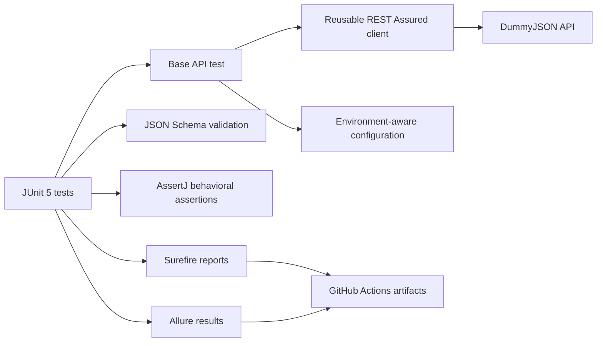

# DummyJSON REST Assured API Automation Portfolio

[](https://github.com/Korpaks/dummyjson-rest-assured-api-portfolio/actions/workflows/api-tests.yml)

A maintainable Java 21 API automation project demonstrating contract, functional, negative, authentication, query, and simulated CRUD testing against the public [DummyJSON](https://dummyjson.com/docs) practice API.

## Quality evidence at a glance

| Signal | Evidence |
|---|---|
| Automated coverage | 27 independent JUnit 5 API tests across six risk areas |
| CI execution | [GitHub Actions API suite](https://github.com/Korpaks/dummyjson-rest-assured-api-portfolio/actions/workflows/api-tests.yml) |
| Contract evidence | JSON Schema checks plus AssertJ behavioral assertions |
| Diagnostics | Surefire XML/text reports, Allure results, and failure-only HTTP logging |
| Safety | Public demo credentials and simulated writes; no shared data is changed |

## What this project demonstrates

- 27 independent JUnit 5 tests across products, auth, carts, posts, todos, and platform health
- REST Assured clients with reusable request configuration
- JSON Schema contract validation
- AssertJ assertions on payload content and cross-field behavior
- Pagination, projection, sorting, search, filtering, and user-scoped resources
- Safe positive and negative authentication coverage
- Non-persistent POST, PUT, PATCH, and DELETE scenarios
- Failure-only request/response logging
- JUnit XML and Allure result generation
- GitHub Actions execution on pushes, pull requests, and manual dispatch

## Test design

| Area | Coverage | Tests |
|---|---|---:|
| Health and HTTP behavior | Service health, content type, unknown route | 3 |
| Product reads and queries | Schema, ID, pagination, projection, sorting, search, category, negative lookup | 9 |
| Product mutations | Simulated create, replace/update, patch, delete, missing resource | 5 |
| Authentication | Login, bearer identity, missing token, bad password, missing field | 5 |
| Related resources | User carts/posts/todos, post search, todo pagination | 5 |
| **Total** | | **27** |

Tests assert stable contracts and relationships rather than volatile catalog values. Every test creates its own request context; no test depends on execution order. DummyJSON mutations are simulated by the service and do not alter shared data.

## Run locally

Prerequisites: JDK 21 and Maven 3.8+.

```bash
mvn clean test
```

Optional environment overrides:

```bash
export DUMMYJSON_BASE_URL=https://dummyjson.com
export DUMMYJSON_USERNAME=emilys
export DUMMYJSON_PASSWORD=emilyspass
mvn clean test
```

If a corporate proxy or an outdated local Java trust store intercepts HTTPS, `DUMMYJSON_RELAXED_TLS=true` can be used for a local diagnostic run only. It is disabled by default and is never enabled in CI.

The defaults are public demo credentials documented by DummyJSON—not private credentials. Tokens are generated at runtime and are never stored.

Reports are written to `target/surefire-reports`, while Allure-compatible raw results are written to `target/allure-results`. To view Allure locally, install the Allure CLI and run `allure serve target/allure-results`.

## Structure

```text
src/test/java/com/igorkorpak/api/
├── client/DummyJsonClient.java   # reusable HTTP operations
├── config/ApiConfig.java         # properties with environment overrides
├── AuthApiTest.java
├── HealthApiTest.java
├── ProductMutationApiTest.java
├── ProductReadApiTest.java
└── ResourceApiTest.java
src/test/resources/
├── config.properties
└── schemas/                      # JSON contract schemas
```

## Architecture



## Engineering choices

- **REST Assured + AssertJ:** readable HTTP flows with expressive assertions.
- **JUnit 5:** standard lifecycle, discovery, and CI integration.
- **Failure-only logging:** clean successful runs and actionable failure evidence.
- **Environment overrides:** the same suite can target another compatible environment without source edits.
- **Safe mutations:** tests exercise write semantics without polluting a real system.

## Known boundaries and tradeoffs

- DummyJSON simulates mutations, so the suite verifies request/response semantics rather than durable database state.
- Public demo credentials are intentionally used; production authentication and secret-management flows are outside scope.
- Performance, rate-limit, destructive, and security testing are excluded because the shared public API is not an authorized load or penetration target.
- Schemas protect stable response contracts without over-constraining volatile catalog values.
- Allure results are generated in CI, but publishing a permanent Allure site is intentionally avoided to keep the portfolio dependency-light.

## Responsible use

This repository contains only public practice data and intentionally invalid negative-test values. It contains no employer code, personal access tokens, or private credentials.

## Author

**Igor Korpak** — QA automation portfolio

[LinkedIn](https://www.linkedin.com/in/igor-korpak/) · [GitHub](https://github.com/Korpaks)
